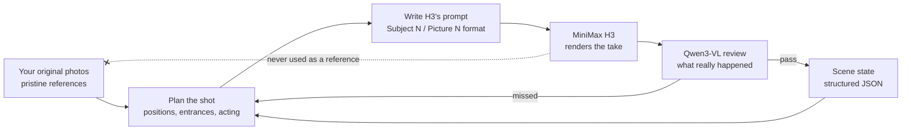

# 🎬 Director Studio

**A directing studio for multi-shot AI film, built on ComfyUI and MiniMax H3 (reference-to-video).**

You describe the scene, pick your actors and their photos, and the Director does the rest: it plans the shot, writes H3's
prompt, places everyone in the frame, renders the take, reviews it with a local vision-language model, and keeps a history
of every decision so the next shot carries the story on.

This repository is the source of the **public 24 GB demo**. It runs on an ordinary 24 GB GPU and installs itself on a
rented Vast.ai machine.

**▶ Try it:** [rent the Director Studio template on Vast.ai](https://cloud.vast.ai?ref_id=711729&template_id=54630e740d4e45cbda43851316ece730)
· the install bundle lives on [Hugging Face](https://huggingface.co/Walkerb09/Director-demo) (SHA-256 verified)

---

## The problem it solves

Video models drift when you chain shots. Feed shot 3 the last frame of shot 2 and every generation inherits the previous
one's small errors: faces soften, clothes change, colors shift, and by shot 6 the actors are strangers.

**Clean Chain** is the Director's answer: *no generated frame or clip is ever used as a reference.* Every shot is built
from your original photos (and crops of them). What carries over between shots is **structured text**, not pixels: a local
Qwen3-VL model watches each accepted take and writes down what actually happened (who is where, facing which way, doing
what, with which expression), and the next shot is planned from that.

## What it does

- **Directs, not just prompts.** Write what should happen in plain words; the Director turns it into H3's official
  `<Subject N>` / `<Picture N>` prompt format with timing, entrances, movement and dialogue.
- **Keeps people consistent.** Each actor has one main reference that sets clothes, hair and makeup; extra face and body
  photos only support it, so outfits never mix. Faces are checked against the references (YuNet + SFace).
- **Puts people where you asked.** A position setter places each actor; takes are checked for people who drifted or
  swapped sides, and the misses are retaken.
- **Reviews its own takes.** A local Qwen3-VL model describes each take, so continuity is carried in words.
- **Project history.** Every decision is logged: undo, retake, compare A/B takes, trim or split clips in the editor.
- **Runs locally.** No paid APIs; every model runs on the rented GPU.

More detail: [docs/ARCHITECTURE.md](docs/ARCHITECTURE.md).

## Running it

The easy way is the Vast.ai template above: rent a machine with a 24 GB GPU, watch the install log, restart ComfyUI when
it says `DEMO INSTALL COMPLETED`, then open your ComfyUI link with `/director` at the end.

The template runs `director_demo_provision.sh`, which downloads the bundle from the public Hugging Face repo, **checks its
SHA-256 against `latest.json` before unpacking anything**, and starts the installer. Model weights (MiniMax H3, Qwen3-VL)
are downloaded on the machine from their official repositories; they are far too large for git.

The demo uses Comfy-Org's smaller H3 files and Qwen3-VL 8B, so its takes are a little less detailed than the full
BF16 setup the Director was developed on.

## Repository layout

| folder | what's in it |
|---|---|
| `ComfyUI-DirectorStudio/` | the Director itself: a ComfyUI custom node package with the `/director` web app and its integrity manifest (`verify_package.py`) |
| `installer/` | the demo installer (`install.sh`, `install.py`, `check_ready.py`), the observer and queue add-ons it installs (`payload/`), and the Vast.ai template files (`vast_template/`) |
| `docs/` | architecture notes |

In the release bundle the `payload/` add-ons are zips (their SHA-256 values are in `payload_manifest.json`); here they are
unpacked so the code can be read. The face and cut-out models aren't in git: see
[ComfyUI-DirectorStudio/models/README.md](ComfyUI-DirectorStudio/models/README.md).

## How it was built

I designed and directed this project: the Clean Chain architecture, the planning, identity and review workflows, the
acceptance criteria and the testing. The code was written with AI coding assistants (Claude, ChatGPT) under that design,
and every change was validated with controlled tests: same-seed A/B comparisons with explicit pass/fail criteria, plus
an offline automated test suite in the development version (its fixtures use personal reference photos, so it isn't
part of this public demo). The package carries an integrity manifest of every file (`verify_package.py`).

## Security

Secrets never live in this repository or in the public template: the demo needs no token at all, and the private
development setup reads its Hugging Face token from environment variables only. Release bundles are verified by SHA-256
before they are unpacked. See [SECURITY.md](SECURITY.md).

## License

Director Studio is open source under the [MIT License](LICENSE). The models it downloads (MiniMax H3, Qwen3-VL, the
YuNet / SFace face models) keep their own licenses.
