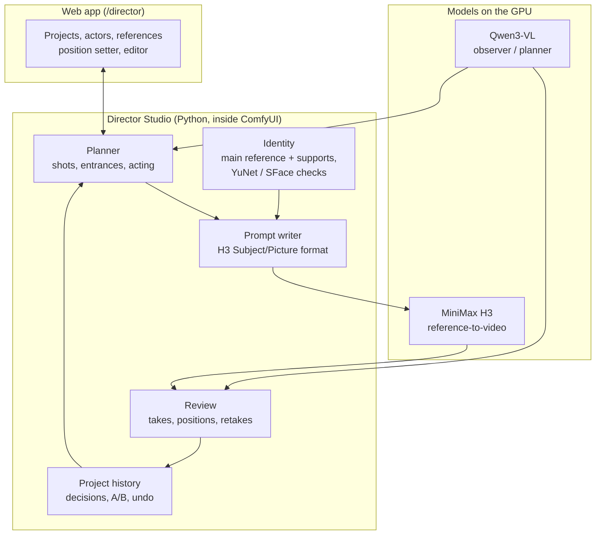
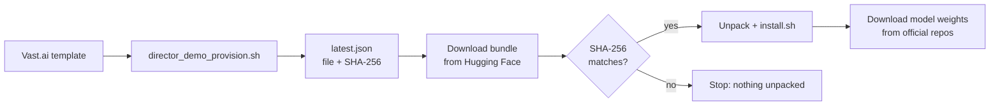

# Architecture

Director Studio is a ComfyUI custom node package (`ComfyUI-DirectorStudio`) with a web app served at `/director`,
plus an installer and a Vast.ai provisioning script.

## The pieces

## Clean Chain

The rule the whole design follows: **generated frames and clips are never used as references.**

- Every shot's references come from the user's original photos (and crops or cut-outs made from them).
- What carries between shots is a structured **scene state**: positions, facing, action, expressions and story beats,
  written by Qwen3-VL from the frames of the accepted take.
- Because nothing generated is fed back in, quality and identity don't degrade over a long sequence.

## Identity

Each actor has **one main reference** (it decides clothes, hair and makeup) and any number of supporting face and body
photos. The supports help the face; they never change the outfit, so looks don't blend. Faces in takes are compared with
the references (YuNet detection + SFace embeddings).

## Positions and review

The position setter places each person in the frame (feet on the spot, sized by distance). After a take, the review
checks that people are where they were placed and haven't swapped sides, and flags takes to redo.

## Testing approach

Changes were validated with controlled experiments: the same seed with one variable changed (A/B), and explicit pass/fail
criteria written before the test, and an offline automated test suite in the development version. The public package
carries an integrity manifest of every file.

## Deployment

